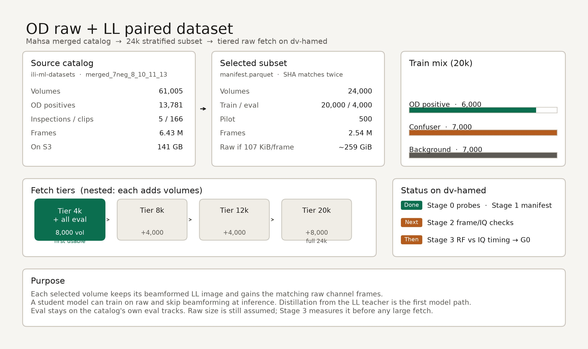
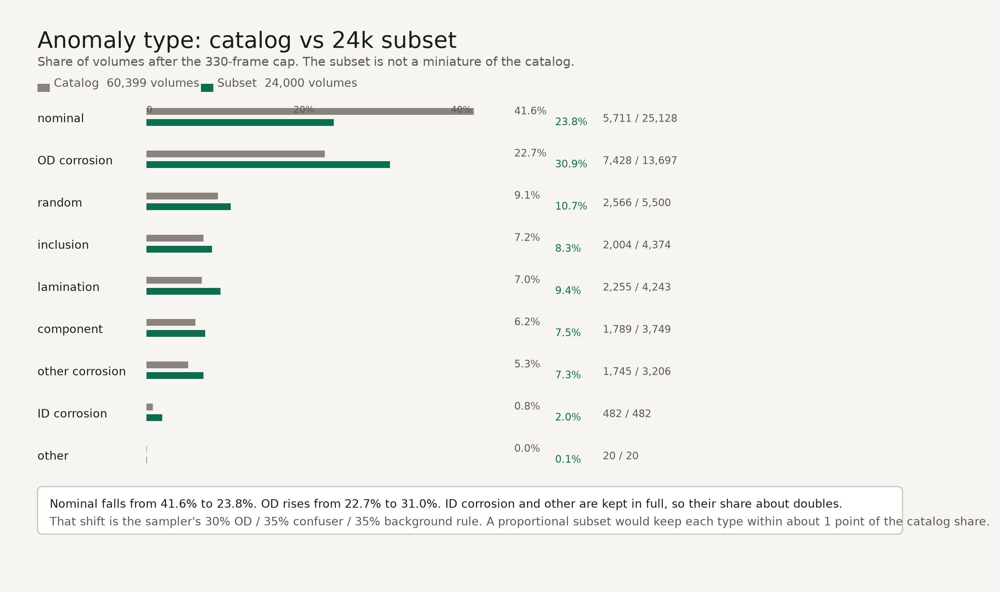

# od_raw_ll

Each OD corrosion LL window is paired with the raw IQ frames it was beamformed from. A later model can then run on raw data and skip beamforming.

This repo holds the plan and the record. The catalog is not in git.

> [!WARNING]
> **Open**
> - **Stage 8.** Paired loader is not written.
> - **Stage 9.** Teacher cache and distillation are not started. After that, G2: keep distilling, fetch more, or try a shared embedding.
> - **Two inspections do not rebuild.** `0ABP0TFUSH1` and `0AGBXB4WEGN` are in the 24k, but their stored LL does not match a re-beamform. That check is skipped for them. [artifacts/p4/p4_rebeamform.md](artifacts/p4/p4_rebeamform.md)
> - **One clip, unread against LL.** `01-022-18AJ0FOL`: the reader logged a frame-count mismatch. Its 79 tier-4k volumes re-read to the stored hashes. They were not compared to their LL images.
> - **Old docs.** `scripts/README.md`, `scripts/PLAN.md`, `scripts/catalog_census.json`, and `scripts/od_raw_ll_plan.pptx` still describe the retired 26k catalog.

## The 24k dataset

**Where:** local `catalog/` on `dv-hamed` (about 315 GB). Shared copy: `s3://ili-ml-datasets/lancedb/research/hamed/od_raw_ll`.

**Size:** 24,000 volumes, 20,000 train and 4,000 eval, 2,536,664 frames, all 166 clips, 5 inspections.

| Table | Rows | What it holds |
|---|---|---|
| `volumes` | 24,000 | LL image (JP2 bytes). Train is lossy. Eval also has lossless. |
| `raw_volumes` | 24,000 | IQ frames: int16, `(n, 128, 204, 2)`, no upsample, uncompressed. Stores `content_sha256`. |
| `dataset` | 24,043 | One row per sample. 42 volumes have 2 or 3 samples. |
| `annotations` | 7,468 | Positives only. |
| `subset` | 24,000 | `tier`, `pilot`, `group`, `depth_bin`, `sample_weight`. |

**Pairing:** join `volumes` and `raw_volumes` on `volume_id`. Each volume has exactly one raw row.

**Tiers:** train 4k, 8k, 12k, 20k, nested. Eval is the same 4,000 volumes in every tier. The 500-volume pilot is inside the first tier.

**Loading:** `dataset` has two columns the workflow schema does not: `prediction_confidence_pct` and `sample_category`. Open it with the live table schema, not `dataset_schema()`.

**Checks:** each tier passed pairs, blob hashes, counts, fresh reads, a re-beamform sample, and the S3 round trip. Reports: `work/validation_tier{4000,8000,12000,20000}.json`.

**Tag:** `od-raw-ll-v1` pins this snapshot. `volumes` and `raw_volumes` version 3002, `dataset` 785, `annotations` 559, `subset` 6.

## Status

**Done:** the 24k subset is built, checked, and copied to S3. Open items are at the top.

## Files

| File | What it is |
|---|---|
| [plans/staged_build.plan.md](plans/staged_build.plan.md) | The build, stage by stage. |
| [plans/subset_sampler.plan.md](plans/subset_sampler.plan.md) | How the 24,000 volumes were chosen. |
| [artifacts/manifest.parquet](artifacts/manifest.parquet) | The 24,000 selected volumes. |
| [artifacts/p4/p4_rebeamform.md](artifacts/p4/p4_rebeamform.md) | LL re-beamform check per inspection. |
| [artifacts/raw_timings_iq_up0.json](artifacts/raw_timings_iq_up0.json) | Raw-form timing, the chosen IQ form. |

Source catalog (read-only): `s3://ili-ml-datasets/lancedb/research/mahsa/kraken/od_corrosion/ll/merged_7neg_8_10_11_13`, namespace `kraken/od_corrosion`.

`scripts/README.md`, `scripts/PLAN.md`, `scripts/catalog_census.json`, and `scripts/od_raw_ll_plan.pptx` describe a retired 26k catalog. Do not use them.
