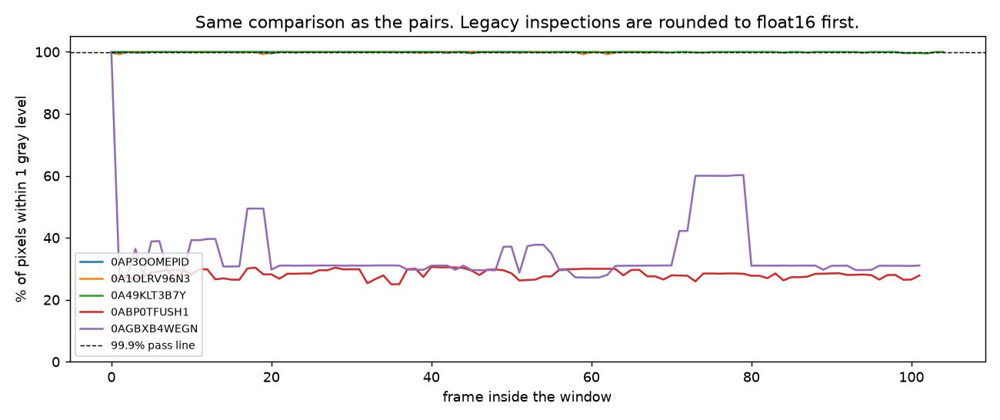
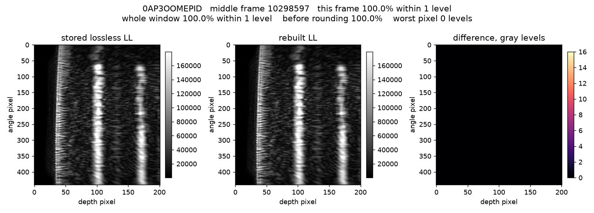
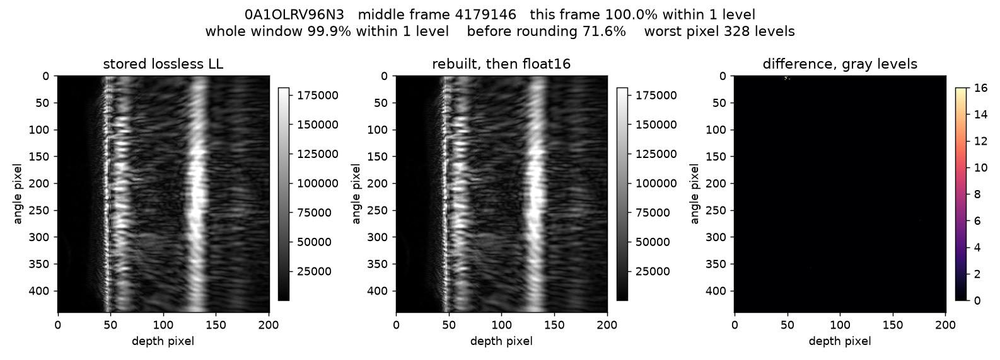
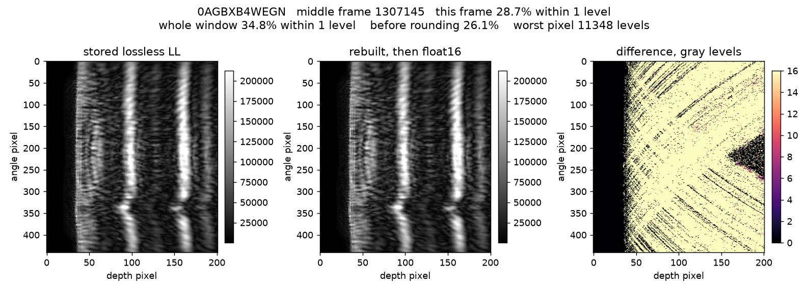

# P4: does a rebuilt LL match the stored one?

13 Nov 2026. The question is whether beamforming the same frames again reproduces the lossless LL image in the catalog.

Pass line, fixed before the run: at least 99.9% of pixels within 1 gray level.

The first comparison failed four inspections. Most of that gap is the way those four were saved. Their LL was copied from an older dataset that stored each frame as float16, which keeps about 3 digits. The JPEG2000 in the catalog is a lossless copy of that already-rounded image. Comparing a full-precision rebuild against it counts the rounding as error.

`0AP3OOMEPID` was written by the current sampler at full precision. It matches exactly, so the rebuild itself is right.

## How the two pictures are made

**Stored image.** The catalog stores `lossless_frame_bytes` plus per-frame offsets and lengths. `Jp2Decoder` turns each slice back into a `uint16` picture, 0 to 65535, shape `(n_frames, 441, 201)`.

The writer scaled the float image with the row's `vol_vmin` and `vol_vmax`:

```text
stored = round((x - vmin) / (vmax - vmin) * 65535)
```

On these windows `vmin` is 0 and `vmax` is about 273,000 to 338,000. One gray level is about 4 to 5 float units.

**Where the four stored images came from.** Every row of `0A1OLRV96N3`, `0A49KLT3B7Y`, `0ABP0TFUSH1`, and `0AGBXB4WEGN` was inserted in the same half-second, copied from `s3://dv-ml-data/od_corrosion_detection/v4_v3_v2`. That dataset keeps each frame as a 0–1 float16 value. The legacy file and the catalog image are identical on all 28 windows checked: difference 0. The copy lost nothing. The rounding happened when the old dataset was built.

**Rebuilt image.** Same frames, the production LL settings, which match `beamform_ll_window` in the sampling flow:

1. Open the inspection and the clip.
2. Fit one circle per frame from that inspection's ID-surface file.
3. Beamform with `OuterSurfaceDetect`, `LL_DEFAULTS`, and the pipe inner radius taken from the median circle radius.
4. The beamformer reads the clip's own channel data.

P3 handed the beamformer our IQ-without-upsample array. That matched this rebuild exactly, difference 0, on all five inspections.

**The comparison.** For the four legacy inspections, the rebuild is put through the same float16 rounding before it is scaled to 0–65535 and subtracted. For `0AP3OOMEPID` there is no rounding step. A pixel matches when the absolute difference is 0 or 1 gray level.

## How to read the figures

- Left is the stored image. Middle is the rebuild after the rounding that inspection was saved with. They share one brightness scale, the 1st to 99th percentile of the stored middle frame.
- Right is the difference in gray levels, 0 to 16 on every inspection. Black is a match. Yellow is 16 or more levels off. The pass line is 1 level, so yellow is a miss.
- The percent on a grid row is the whole window, after rounding. The single-window titles also show the percent before rounding.
- The strip chart uses the same 99.9% line. Green reaches it.

## Result on the original five windows

| Inspection | Before rounding | After the stored rounding | Worst pixel after | Verdict |
|---|---|---|---|---|
| `0AP3OOMEPID` | 100% | 100% (no rounding; it was stored at full precision) | 0 | Pass |
| `0A1OLRV96N3` | 71.6% | 99.92% | 328 | Pass |
| `0A49KLT3B7Y` | 67.0% | 99.94% | 3,808 | Pass |
| `0AGBXB4WEGN` | 26.1% | 34.8% | 11,348 | Fail |
| `0ABP0TFUSH1` | 22.0% | 28.3% | 19,288 | Fail |



On `0A1OLRV96N3` and `0A49KLT3B7Y` the line sits on the pass line. The remaining miss is a few pixels: 99.9% of each window is exact, and one pixel still reaches hundreds or thousands of levels. On `0AGBXB4WEGN` and `0ABP0TFUSH1` rounding barely moves the line.

## The pairs

### `0AP3OOMEPID` — pass

Volume `1074d0fd-6f4d-5246-8db5-3dfa44c2961d`, clip `01-001-18AJ0C8D`, frames 10298571–10298623. `vmax` 318,732. Written at full precision, so no float16 step.



The difference panel is black. Every pixel in all 53 frames is identical.

### `0A1OLRV96N3` — pass, once rounded the same way

Volume `0005b152-9eef-51e5-9915-210204d6ba05`, clip `01-013-114ZP5VY`, frames 4179111–4179180. No eval OD positive, so this is a random background window. `vmax` 328,103.



Before rounding, 71.6% of pixels were within 1 level and the difference followed the bright wall. After the same float16 rounding, 99.92% are within 1 level and 99.9% are exact. The difference panel goes dark. One pixel in the window is still 328 levels off.

### `0A49KLT3B7Y` — pass, once rounded the same way

Volume `e7959c75-ceed-519e-a855-a3deafeb5aaa`, clip `01-011-11YWDVD4`, frames 6735163–6735267. `vmax` 273,391.


Same change. 67.0% before rounding, 99.94% after. 99.9% of pixels are exact. One pixel reaches 3,808 levels.

### `0AGBXB4WEGN` — still fail

Volume `4e53520e-966f-5de1-b866-f7e32d488a39`, clip `01-000-15LR96LM`, frames 1307094–1307195. `vmax` 338,198. Surface folder is `ili_ml_surface/` with no `v1.2`.



Float16 moves this window from 26.1% to 34.8%. The difference stays yellow, with diagonal streaks: the bright bands do not land on the same pixels. The 99.9th percentile is 4,848 levels. The worst pixel is 11,348.

### `0ABP0TFUSH1` — still fail

Volume `7d0f544b-fedd-58a4-b777-d7fbe9ad9d4a`, clip `01-012-145IKTIF`, frames 5528611–5528712. `vmax` 309,429.


22.0% before rounding, 28.3% after. Same streaks. The 99.9th percentile is 4,904 levels. The worst pixel is 19,288.

## 36 windows

8 per inspection, 5 for `0A1OLRV96N3`. The percent in each grid is after the rounding that inspection was stored with. Window list: `more_windows.json`. Numbers: `more/summary.json`.

| Inspection | Windows | Pass after rounding | Within 1 level after rounding |
|---|---|---|---|
| `0AP3OOMEPID` | 8 | 8 | 100% |
| `0A1OLRV96N3` | 5 | 2 | 99.73% to 99.98% |
| `0A49KLT3B7Y` | 8 | 7 | 99.86% to 99.98% |
| `0ABP0TFUSH1` | 7 | 0 | 28.3% to 99.86% |
| `0AGBXB4WEGN` | 8 | 0 | 30.8% to 95.8% |


- [`0AP3OOMEPID`](more/0AP3OOMEPID_grid.jpg)
- [`0A1OLRV96N3`](more/0A1OLRV96N3_grid.jpg)
- [`0A49KLT3B7Y`](more/0A49KLT3B7Y_grid.jpg)
- [`0ABP0TFUSH1`](more/0ABP0TFUSH1_grid.jpg)
- [`0AGBXB4WEGN`](more/0AGBXB4WEGN_grid.jpg)

`0A1OLRV96N3` and `0A49KLT3B7Y` sit on the line. The three windows under 99.9% miss by a few hundredths of a percent, from a handful of pixels. `0ABP0TFUSH1` and `0AGBXB4WEGN` stay spread out, and their grids still show the streaks. One `0ABP0TFUSH1` window reaches 99.86% and still fails the line.

## What this does and does not say

The rebuild matches the sampling flow, and it matches the catalog exactly where the catalog was stored at full precision.

For `0A1OLRV96N3` and `0A49KLT3B7Y` the earlier miss was the float16 rounding in the old dataset. The ID-surface file and the beamform settings reproduce the stored image once that rounding is applied. A few pixels per window still disagree.

For `0ABP0TFUSH1` and `0AGBXB4WEGN` the rounding explains only a few points. The stored image and the rebuild disagree about where the wall sits. The surface files on S3 are older than the legacy build, so they were not replaced afterwards. What that build used differently is not identified.

Numbers behind the figures: `figures/summary.json` and `more/summary.json`.
