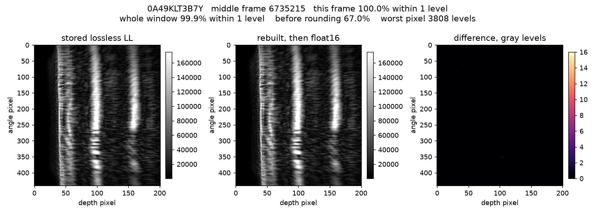
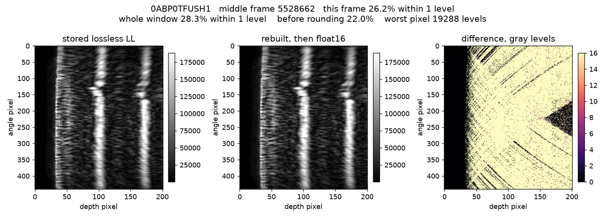
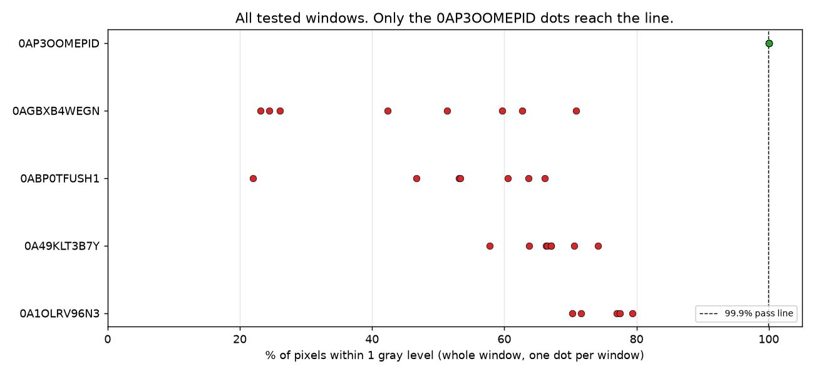

# P4: does a rebuilt LL match the stored one?

13 Nov 2026. One short eval window per inspection. The question is whether beamforming those frames again, with the ID-surface file we have, reproduces the lossless LL image already in Mahsa's catalog.

Pass line, fixed before the run: at least 99.9% of pixels within 1 gray level. One inspection passes. Four do not.

## How the two pictures are made

**Stored image, the answer key.** The catalog does not store pixels. The `volumes` row holds `lossless_frame_bytes`, a packed blob, plus `lossless_frame_offsets` and `lossless_frame_lengths`, one pair per frame. Each slice is a JPEG2000 payload. `Jp2Decoder` turns it back into a `uint16` picture, values 0 to 65535, shape `(n_frames, 441, 201)`.

The writer had scaled the float image into that range with the row's `vol_vmin` and `vol_vmax`:

```text
stored = round((x - vmin) / (vmax - vmin) * 65535)
```

On these five windows `vmin` is 0 and `vmax` is between about 273,000 and 338,000. Inverting the scale gives the float image shown on the left of each figure.

**Rebuilt image.** Same frames, the production LL settings:

1. Open the inspection and the clip.
2. Download that inspection's ID-surface parquet for the frame range and fit one circle per frame. The circle is where the pipe center is.
3. Beamform with `OuterSurfaceDetect`, the LL angle and depth grid (`LL_DEFAULTS`), and the pipe inner radius taken from the median circle radius.
4. The beamformer reads the clip's own channel data.

A separate check (P3) handed the beamformer our IQ-without-upsample array instead of letting it read the clip. That matched this rebuild exactly, difference 0, on all five inspections. Upsampled IQ was rejected: the beamformer wants `(204, 128)` and those frames are `(680, 128)`.

**The comparison.** Put the rebuilt float back through the same 0–65535 scaling and subtract from the stored `uint16`. A pixel matches when the absolute difference is 0 or 1 gray level.

## How to read the figures

Every inspection is drawn the same way, so the panels compare.

- Left and middle share one brightness scale: the 1st to 99th percentile of the stored middle frame. A bright band on the left is the same brightness on the middle.
- Right is the difference in gray levels, and the color scale is 0 to 16 on every inspection. Black is a match. Yellow is 16 or more levels off, including errors of thousands. The pass line is 1 level, so yellow is a miss.
- The title percentage on a single frame is that frame. The window percentage is every pixel in the window.
- The line chart uses the same pass line, 99.9%, for every inspection.

The eye is a bad judge of the left and middle panels alone. A shift of tens of gray levels is invisible next to a pipe wall that spans hundreds of thousands of float units. The right panel and the line chart are the comparison.

## Result

| Inspection | Window | Surface | Within 1 level | Exact | Worst pixel | Middle frame within 1 | Verdict |
|---|---|---|---|---|---|---|---|
| `0AP3OOMEPID` | 53 frames, OD | `s3://dv-ilit0013/track_runs/0AP3OOMEPID/ili_ml_surface` | 100% | 100% | 0 | 100% | Pass |
| `0A1OLRV96N3` | 70 frames, random (no eval OD) | `s3://dv-ilit0007/track_runs/0A1OLRV96N3/ili_ml_surface/v1.2` | 71.6% | 42.4% | 324 | 72.8% | Fail |
| `0A49KLT3B7Y` | 105 frames, OD | `s3://dv-ilit0008/track_runs/0A49KLT3B7Y/ili_ml_surface/v1.2` | 67.0% | 39.0% | 3,816 | 69.3% | Fail |
| `0AGBXB4WEGN` | 102 frames, OD | `s3://dv-ilit0011/track_runs/0AGBXB4WEGN/ili_ml_surface` | 26.1% | 18.7% | 11,349 | 21.8% | Fail |
| `0ABP0TFUSH1` | 102 frames, OD | `s3://dv-ilit0010/track_runs/0ABP0TFUSH1/ili_ml_surface/v1.2` | 22.0% | 15.8% | 19,287 | 20.7% | Fail |

Every frame of the four failures is under the 99.9% line. The miss is not one bad frame.


`0AP3OOMEPID` sits on 100% for all 53 frames. `0A1OLRV96N3` stays near 72% and `0A49KLT3B7Y` near 67%, flat across the window. `0ABP0TFUSH1` stays near 22%. `0AGBXB4WEGN` starts near 62% for a couple of frames, drops to about 25%, and has a short bump to about 40% around frame 70 of the window.

## The pairs

### `0AP3OOMEPID` — pass

Volume `1074d0fd-6f4d-5246-8db5-3dfa44c2961d`, clip `01-001-18AJ0C8D`, frames 10298571–10298623. `vmax` 318,732.


The difference panel is black. Every pixel in all 53 frames is identical after scaling. This is the surface folder the stored LL was built from, and the decode-plus-rebuild path is right.

### `0A1OLRV96N3` — fail

Volume `0005b152-9eef-51e5-9915-210204d6ba05`, clip `01-013-114ZP5VY`, frames 4179111–4179180. This inspection has no eval OD positive, so the window is a random background volume. `vmax` 328,103.


About 72% of pixels are within 1 level on every frame. The worst pixel in the window is 324 levels, and on the middle frame 133. The 99.9th percentile of the error is 16 levels, so the miss is a thin tail plus a lot of pixels a few levels off. The left and middle panels still look like the same pipe.

### `0A49KLT3B7Y` — fail

Volume `e7959c75-ceed-519e-a855-a3deafeb5aaa`, clip `01-011-11YWDVD4`, frames 6735163–6735267. `vmax` 273,391.



Same pattern as `0A1OLRV96N3`: about 67% within 1 level, flat across all 105 frames, 99.9th percentile 16 levels. The difference lights up along the bright wall bands. A few pixels reach 3,816 levels. The middle frame itself never exceeds 16.

### `0AGBXB4WEGN` — fail

Volume `4e53520e-966f-5de1-b866-f7e32d488a39`, clip `01-000-15LR96LM`, frames 1307094–1307195. `vmax` 338,198. This inspection has no `v1.2` folder. The surface used is `ili_ml_surface/` with the track folders directly underneath.


The middle frame is 21.8% within 1 level, and most of the difference panel is at or past 16 levels. The structure in the difference follows the wall bands, which is what a shifted pipe center looks like. The worst pixel is 11,349 levels. The 99.9th percentile is 4,849.

### `0ABP0TFUSH1` — fail

Volume `7d0f544b-fedd-58a4-b777-d7fbe9ad9d4a`, clip `01-012-145IKTIF`, frames 5528611–5528712. `vmax` 309,429.



Worst of the five. 22.0% of the window is within 1 level, the middle frame 20.7%, and the middle frame alone reaches 8,406 levels. The window worst is 19,287. The 99.9th percentile is 4,903. Its difference is diagonal streaks, not the wall-shaped pattern of the other inspections (see the 36-window section).

## More windows: 36 tested

The same check on 36 windows, 8 per inspection (5 for `0A1OLRV96N3`), with a mix of anomaly types. Window list: `more_windows.json`. Numbers: `more/summary.json`.

| Inspection | Windows | Passed | Within 1 level, range over windows |
|---|---|---|---|
| `0AP3OOMEPID` | 8 | 8 | 100% |
| `0A1OLRV96N3` | 5 | 0 | 70.3% to 79.4% |
| `0A49KLT3B7Y` | 8 | 0 | 57.8% to 74.2% |
| `0ABP0TFUSH1` | 7 | 0 | 22.0% to 66.1% |
| `0AGBXB4WEGN` | 8 | 0 | 23.1% to 70.8% |



Grids, one per inspection. Rows are windows, columns are stored LL, rebuilt LL, and difference on a 0 to 16 gray-level scale. The percent on each row is the whole window.

- [`0AP3OOMEPID`](more/0AP3OOMEPID_grid.jpg)
- [`0A1OLRV96N3`](more/0A1OLRV96N3_grid.jpg)
- [`0A49KLT3B7Y`](more/0A49KLT3B7Y_grid.jpg)
- [`0ABP0TFUSH1`](more/0ABP0TFUSH1_grid.jpg)
- [`0AGBXB4WEGN`](more/0AGBXB4WEGN_grid.jpg)

The failure is per inspection, not one bad window. Every window of the four failing inspections is under the line. Their ranges overlap, so the earlier "close" and "far" grouping is not supported.

What the difference panels show:

- `0A1OLRV96N3` and `0A49KLT3B7Y`: the difference follows the bright wall bands, with a few levels of error across most pixels.
- `0ABP0TFUSH1`: long diagonal streaks run across the difference panels. They look like edges displaced by a changing amount, not random noise. The cause is not identified yet.

## What this does and does not say

The rebuild method is right. `0AP3OOMEPID` is exact on all 8 windows, and P3 showed the raw IQ we would store produces that same beamform.

The other four inspections use an ID-surface folder that does not reproduce their stored LL, on every window tested. The 36-window run confirms the single-window result; it is not one bad window.

The pilot should not start until each of those four has a surface folder that clears 99.9%. The next step is to look for another version of those surfaces, or to ask which file the stored LL was built with.

Numbers behind the figures: `figures/summary.json`. The check that produced the pass/fail calls: `p4.json`, `id_surfaces.json`, and `test_windows.json` in this folder.
