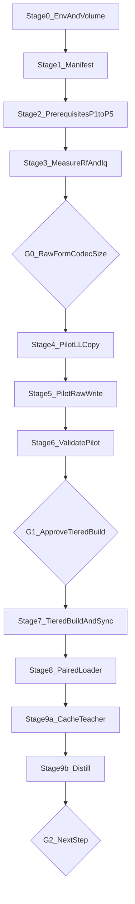

# OD raw + LL paired dataset: staged build

Revised 12 Nov 2026. The earlier version of this plan targeted an older, smaller catalog. What changed is listed in "Changes from the previous version" at the end.

## Context

**Why.** Beamforming (BF) is the expensive step in OD corrosion detection. If a model can work from the channel data that beamforming reads, inference can skip it. The first need is a dataset holding both forms for the same frames.

**Origin.** Whiteboard session, 10 Nov 2026. It proposed: take a subset of the mahsa OD Lance dataset, fetch the corresponding raw, copy the BF volumes alongside it as a new catalog, estimate the prep time first, then try (I) a shared VAE embedding or (II) distillation from an LL model (M1) into a raw model (M2).

**Prior artifacts.**

- Sampler design: `od_subset_sampler_c21f37df.plan.md` (same plans folder). Stage 1 implements it.
- [scripts/README.md](scripts/README.md), [scripts/PLAN.md](scripts/PLAN.md), [scripts/catalog_census.json](scripts/catalog_census.json), share deck and canvas: all describe the **old** catalog and are refreshed under `refresh-docs`.
- [scripts/catalog_census.py](scripts/catalog_census.py), [scripts/time_raw_window.py](scripts/time_raw_window.py), [scripts/estimate.py](scripts/estimate.py): reused, re-pointed.
- `od_chunk_prefetch_report.md`: source of the 107 MiB per 1,024-frame figure and the session limits (16 HTTP requests, 512 MiB HTTP cache, 256 MiB central cache).

**People.** Mahsa owns the source catalog.

## Decided

- **Source:** `s3://ili-ml-datasets/lancedb/research/mahsa/kraken/od_corrosion/ll/merged_7neg_8_10_11_13`, namespace `kraken/od_corrosion`. Read-only.
- **Subset:** 24,000 volumes, 20,000 train and 4,000 eval, stratified (spec in `od_subset_sampler_c21f37df.plan.md`). Train mix 30% OD positive, 35% confuser, 35% background. Nested train tiers 4,000 / 8,000 / 12,000 / 20,000. Pilot of 500 inside the first fetch (train tier 4,000 plus all eval).
- **Raw form:** measure RF and IQ (both `upsample` settings), then pick at G0. IQ is the default because only IQ allows the re-beamform check.
- **Compute and storage:** `dv-hamed` (`i-023016cf319153c36`, g5.2xlarge, A10G 23 GB), reached with `ssh dv-hamed` over SSM. The host name `ec2-hamed` is retired. Build on the root EBS volume (`/`, 779 GB free on 12 Nov 2026); it persists across a stop. `/opt/dlami/nvme` is a 391 GB instance store and is wiped on stop, so it is not the catalog store. S3 holds the shared, tagged copy.

## Source catalog (measured 12 Nov 2026)

- 61,005 volumes, 61,075 dataset rows, 13,781 OD annotations, 6,426,507 frames, 166 clips. All `mode=ll`, JP2, 441 x 201. Split 54,175 train / 6,900 eval.
- Frames per volume: median 88, mean 105, 99th percentile 330, max 2,544.
- Size on S3 141.0 GB: 42.3 GB lossy JP2, 98.6 GB lossless JP2 on 6,895 eval volumes, the rest metadata.
- Inspections (volumes / OD samples): `0AP3OOMEPID` 33,627 / 10,438; `0ABP0TFUSH1` 9,361 / 897; `0A49KLT3B7Y` 6,589 / 92; `0A1OLRV96N3` 6,139 / 0; `0AGBXB4WEGN` 5,289 / 2,354.
- Classes: nominal 25,559; od_corrosion 13,781; random 5,500; inclusion 4,389; lamination 4,369; component 3,753; other_corrosion 3,219; id_corrosion 482; other 23.
- Every dataset row's volume exists (no orphans). 68 volumes carry 2 or 3 dataset rows: 62 OD pairs or triples and 6 other same-class pairs. All share class and split.
- Same table and column layout as the old catalog, so the existing schemas (`volumes_schema`, `annotations_schema`, `dataset_schema`) apply unchanged.

## The 24k subset (simulated at the spec, hash `sha1(f"{20261112}:{volume_id}")`)

- All 166 clips covered. Train share of `0AP3OOMEPID` 37.4% (53% in the catalog).
- 2,536,789 frames. No selected window pair overlaps across train and eval.
- OD positives by depth, subset / pool: up to 0.8 mm 693 / 730; 0.8 to 1.0 mm 1,752 / 4,728; 1.0 to 1.3 mm 1,674 / 3,888; 1.3 to 2.0 mm 1,477 / 2,519; above 2.0 mm 404 / 404.
- Eval: all 1,428 eval positives, all 1,295 eval confusers, 1,277 background.

## Size and time budget

Only the LL lossy figure rests on measured bytes. The rest are estimates until Stage 3.

- LL lossy copy: 16.7 GB (6.6 kB per frame, measured rate).
- LL lossless copy for 4,000 eval volumes: about 57 GB (98.6 GB over 6,895 lossless volumes, scaled).
- Raw, uncompressed: 259 GiB **if** raw is 107 KiB per frame. Unmeasured assumption from the prefetch report.
- Total on the volume: about 328 GiB (about 352 GB) plus logs, caches and Lance overhead. Root had 779 GB free on 12 Nov 2026, which is above the 500 GiB target. Re-check `df` at Stage 0. The first fetch (4,000 train plus 4,000 eval) is about a third of that.
- Raw fetch time, scaled from the earlier unmeasured assumptions: roughly 6 to 25 hours on one worker, 1 to 3 hours on eight. The pilot replaces this with a measurement.

## Facts the plan relies on

Paths below are on `dv-hamed`, under `~/core-learning/ILIWorkflows`. Checked against that checkout on 12 Nov 2026.

- The beamformer consumes IQ: `Beamformer.beamform_compound_data` at `ilipyutils/src/ilipyutils/beamforming.py:507`, passed per batch to `pipeline.set_override_channel_data` (line 641). `num_frames` is the first dimension.
- LL is `BfImageType.OuterSurfaceDetect` (`anomaly_sampling/beamform.py`). `_image_mode_to_profile` (`beamforming.py:1312`) returns `ImageProfile.ZeroAngle` unless the enum name contains `neg` or `pos`. `OuterSurfaceDetect` contains neither.
- `LL_DEFAULTS` (`ilipyutils/src/ilipyutils/configs.py:51`): angle ±11° at 0.05°, radius 15-35 mm at 0.1 mm. `beamform_ll_window` uses ML ID-surface circles and `pipe_inner_radius_mm = nanmedian(circles[:, 2])`.
- Stored LL = `round((x - vol_vmin) / (vol_vmax - vol_vmin) * 65535)` as uint16, then JP2. Train has the lossy family only; 6,895 of 6,900 eval rows also have `lossless_frame_*`.
- `volume_id = uuid5(inspection_id, clip_id, mode, frame_start, n_frames)`; the writer accepts only `ll`, `ll_cx` and grid suffixes. Raw gets its own table keyed by the LL `volume_id`.
- Blob-safe copy: `to_batches(blob_handling="all_binary")` then `materialize_blob_batch` (`lance_ingest/promote.py`). Insert-only writes: `LanceCatalog.insert_only`, `merge_insert`.
- Teacher: `window_size` 25 in the LL model configs, `num_repeat` default 5 (`inference.py:179`), per-frame probabilities merged with `triangular_weights` (`inference.py:206`). Read `window_size` from the loaded production config at cache time.
- One environment: workflow `pyproject.toml`, Python 3.11, `ilipyutils[lance,ml,registry]` (lancedb 0.40.0, pylance 10.0.0, pyarrow <18), torch 2.9.1, dinov2. Needs CodeArtifact `dv-software` credentials.

## Open risks

- **Working disk.** Root has 779 GB free, which covers the ~328 GiB estimate. Re-check `df` at Stage 0; free space moves. The instance store must not hold the catalog.
- **Raw size is an assumption.** 259 GiB could be off by a large factor in either direction. Nothing large is fetched before G0.
- **ID-surface locations.** Needed for the re-beamform check and not recorded in the catalog. Known: `0A1OLRV96N3` at `dv-ilit0007/track_runs/0A1OLRV96N3/ili_ml_surface/v1.2`. Version unknown: `0AGBXB4WEGN` (`dv-ilit0011`), `0ABP0TFUSH1` (`dv-ilit0010`). Inferred from the catalog name `merged_7neg_8_10_11_13` and not checked: `0A49KLT3B7Y` in `dv-ilit0008`, `0AP3OOMEPID` in `dv-ilit0013`. P4 resolves these.
- **Frame numbering.** Catalog `frame_start` values reach tens of millions. P1 proves the reader and the beamformer use the same numbering.
- **S3 destination.** `s3://ili-ml-datasets/lancedb/research/hamed/od_raw_ll` (confirmed by you, 12 Nov 2026). Write access is probed in Stage 0. If the probe is denied, the stage stops and the bucket policy is requested; there is no fallback bucket.
- **Volume is a single disk.** The S3 sync after each tier is the only backup.

## Stages and gates



### Stage 0. Environment and volume on dv-hamed

- Code decision (you, 12 Nov 2026): new code lives in the RnD folder, not in the ILIWorkflows checkout. Stage 0 runs `git init` in `~/core-learning/RnD/od_raw_ll` and creates branch `feature-od-raw-ll-pairing` there; each stage is one commit in that repo. The workflow package `~/core-learning/ILIWorkflows` (branch `master`) is imported read-only and not edited.
- `.gitignore` before any data lands: `catalog/`, `work/`, `cache/`. A `git add` of the catalog would try to commit hundreds of gigabytes. `scripts/PLAN.md` and `scripts/README.md` describe the retired 26k catalog; the plans in `plans/` replace them.
- Record the machine:

```bash
ssh dv-hamed
lsblk -o NAME,SIZE,TYPE,MOUNTPOINT,FSTYPE; df -hT; nproc; free -g
nvidia-smi --query-gpu=name,memory.total --format=csv
```

- Working store is the root EBS volume, under this project. `$VOL=/home/ubuntu/core-learning/RnD/od_raw_ll`:
  - `$VOL/catalog`: destination Lance catalog (`kraken/od_corrosion`).
  - `$VOL/work`: manifests, logs, prerequisite and validation JSON.
  - `$VOL/cache`: uv cache and model weights.
- Environment:

```bash
cd ~/core-learning/ILIWorkflows/workflows/od_corrosion_detection
export UV_PROJECT_ENVIRONMENT=$HOME/core-learning/RnD/od_raw_ll/cache/venv
export UV_CACHE_DIR=$HOME/core-learning/RnD/od_raw_ll/cache/uv
export UV_INDEX_DV_SOFTWARE_USERNAME=aws
export UV_INDEX_DV_SOFTWARE_PASSWORD="$(aws codeartifact get-authorization-token --domain darkvision --domain-owner 961437118368 --region us-west-2 --query authorizationToken --output text)"
uv sync --frozen
uv run python -c "import ilipy, lancedb, lance, torch; print(lancedb.__version__, lance.__version__, torch.cuda.is_available())"
```

The index URL is already in that `pyproject.toml` (`dv-software`). `UV_PROJECT_ENVIRONMENT` keeps the virtualenv out of the workflow checkout.

- New `scripts/probe_access.py`: reads one row from the source catalog; creates and drops a one-row table under the S3 destination; writes and reads back a 1 GiB file on the volume and reports MB/s; opens one clip per inspection on the chunk server.
- **Verify:** import line prints `0.40.0 10.0.0 True`; volume size, free space and write speed recorded; S3 probe round-trips; one clip opens for each of the five inspections.
- **Stop** if: free space is under 150 GiB (hard floor: below the first fetch at the assumed raw size; the 500 GiB figure in the Size section is a target, not a stop), the S3 write is denied, or the GPU is missing (Stages 2, 6 and 9 need it).

### Stage 1. Manifest

Runs before any raw access; it needs catalog metadata only.

- New [scripts/select_paired_subset.py](scripts/select_paired_subset.py):

```python
def load_catalog_metadata(catalog_root: str) -> pd.DataFrame: ...   # one row per volume
def allocate(cell_sizes: dict, budget: int, floor: int = 50) -> dict: ...
def order_cell(cell: pd.DataFrame, seed: int) -> pd.DataFrame: ...
def build_manifest(
    meta: pd.DataFrame, *, train_tiers=(4000, 8000, 12000, 20000), eval_size=4000,
    mix=(0.30, 0.35, 0.35), max_frames=330, pilot_size=500, seed=20261112,
) -> pd.DataFrame: ...
```

- Selection rules, groups, tiers, pilot and weights are specified only in [plans/subset_sampler.plan.md](plans/subset_sampler.plan.md). This stage implements that file and does not restate it.
- Manifest columns: `volume_id`, `sample_ids`, `inspection_id`, `clip_id`, `frame_start`, `n_frames`, `split`, `anomaly_type`, `group`, `depth_bin`, `cell_size`, `cell_take`, `sample_weight`, `tier`, `pilot`; sorted by `(inspection_id, clip_id, frame_start)`.
- Writes `$VOL/work/manifest.parquet`, `$VOL/work/selection_report.json` and `$VOL/work/sample_windows.json` (20 windows, 4 per inspection, drawn from the pilot). The existing `scripts/sample_windows.json` is the old catalog's sample and is not an input.
- [scripts/catalog_census.py](scripts/catalog_census.py): `DEFAULT_CATALOG` changed to the merged catalog.
- Tests in `tests/test_select_paired_subset.py` on a small fake catalog.
- **Verify:** two runs byte-identical (parquet SHA-256); no duplicate `volume_id`; every `volume_id` in `volumes`; `split` equals source; tiers nested and the pilot is inside the first fetch; group totals equal the budgets; every eval volume has lossless frames; no overlapping window pair crosses train/eval; all 166 clips present.

### Stage 2. Prerequisites P1 to P5 (read-only, GPU)

New `scripts/check_prerequisites.py`, one subcommand per check, JSON to `$VOL/work/prereq/`. Tested window: the shortest eval positive per inspection; `0A1OLRV96N3` has no positives, so its shortest eval volume.

- **P1 frame numbering.** `Beamformer.beamform_compound_data(frame_range=(s, s+n))` and `ChannelDataReader.get_iq_frames(s, n)` must refer to the same frames: odometer ticks from `_get_odo_and_timer_ticks(frame_range, ZeroAngle)` equal `reader.get_frame_header(i)` for every i.
- **P2 one profile.** `_image_mode_to_profile(OuterSurfaceDetect) == ZeroAngle` at runtime; no steered frames enter the LL pipeline.
- **P3 upsample.** Beamform normally, then with `custom_iq_frames = get_iq_frames(s, n, upsample=u)` for `u` in {False, True}. The matching setting gives max abs difference 0 in float32 and is fixed for the build.
- **P4 ID surfaces.** For each of the five inspections, list candidates under `s3://dv-ilit00NN/track_runs/<id>/ili_ml_surface/` and keep the one whose re-beamformed LL best matches the stored lossless LL (P5 metric). Writes `id_surfaces.json`. An inspection with no match is reported and skipped in the re-beamform check.
- **P5 LL reconstruction tolerance.** Decode stored `lossless_frame_bytes` with `Jp2Decoder`, invert `x = u16 / 65535 * (vmax - vmin) + vmin`, compare with a fresh beamform. The relative error on the matching surface sets the Stage 6 tolerance (expected near 1/65535 of range).
- **Verify:** every P has a JSON with `passed: true`, or `passed: false` plus a reason. Stop on P1 or P3 failure: the pairing would be wrong.

### Stage 3. Measure RF and IQ

- Extend `time_raw_window.py`: for each of the 20 windows and each of `rf`, `iq_up0`, `iq_up1`, record `shape`, `dtype`, KiB per frame, open seconds, cold and warm read seconds, zlib-1 and zstd-3 ratios. One process per form.
- Extend `estimate.py` to read `manifest.parquet` and print, per form and per tier: GiB uncompressed and compressed, hours on 1 and N workers, and the result against the volume's free space from Stage 0.
- **Verify:** all 60 reads succeed; shape constant within an inspection (a difference between inspections is reported, since it decides the student's input shape).
- **G0 (your call):** raw form, codec (`raw` int16 or `zstd3`), and how many tiers fit the volume with 20% headroom.

### Stage 4. LL copy, pilot

- New `scripts/copy_ll_subset.py`:

```python
def copy_ll_rows(source_root: str, dest_root: str, manifest: pd.DataFrame, *, batch_rows: int = 2) -> dict[str, int]
```

- Reads source `volumes` with a `volume_id IN (...)` filter and `blob_handling="all_binary"`, rebuilds blobs with `materialize_blob_batch`, writes with `LanceCatalog.insert_only` into `$VOL/catalog`. Copies **every** `dataset` and `annotations` row whose `volume_id` is in the manifest. Skips ids already present.
- Adds a `subset` table: one row per volume with `tier`, `pilot`, `group`, `depth_bin`, `sample_weight`, so the catalog is self-describing.
- **Verify:** `volumes` count equals the manifest; `dataset` and `annotations` counts equal the source rows for those volumes; `schemas_equal` true; SHA-256 of `frame_bytes`, and of `lossless_frame_bytes` for eval, equal the source for every pilot volume; `ODCorrosionLanceDataset(dest, split="eval")` yields a decoded batch; a second run inserts 0 rows.

### Stage 5. Raw write, pilot

- New `scripts/raw_schema.py` (RnD folder, not the workflow package):

```python
def raw_volumes_schema() -> pa.Schema:
    return pa.schema([
        pa.field("volume_id", pa.string()), pa.field("inspection_id", pa.string()),
        pa.field("clip_id", pa.string()), pa.field("frame_start", pa.int32()),
        pa.field("n_frames", pa.int32()), pa.field("raw_kind", pa.string()),   # "rf" | "iq"
        pa.field("upsample", pa.bool_()), pa.field("shape", pa.list_(pa.int32())),
        pa.field("dtype", pa.string()), pa.field("codec", pa.string()),        # "raw" | "zstd3"
        pa.field("decimation", pa.int32()), pa.field("content_sha256", pa.string()),
        pa.field("created_at", pa.timestamp("us", tz="UTC")),
        blob_field("raw_bytes", inline_size_threshold=0),
    ])
```

- New `scripts/raw_reader.py`:

```python
def read_raw_window(reader: ChannelDataReader, frame_start: int, n_frames: int, *, kind: str, upsample: bool) -> np.ndarray
```

- New `scripts/write_raw_subset.py --tier N | --pilot`: groups the manifest by clip, one `Session` per worker process with the prefetch session limits, one `ChannelDataReader(session, clip, ImageProfile.ZeroAngle)` per clip, queues the clip's windows with `queue_frames` ahead of reading. Hash on the uncompressed bytes. Rows written 8 at a time to the volume. Resume: skip `volume_id`s already in `raw_volumes`. Stops cleanly when volume free space drops under 20 GiB. Logs seconds and bytes per volume to `write_raw_log.jsonl`.
- No beamformer or CUDA in this process (known CUDA, pyarrow and nvimgcodec conflicts).
- Tests: `tests/test_raw_reader.py`, `test_write_raw_subset.py` with a fake reader (schema, hash, resume, low-disk stop).
- **Verify:** pilot completes; `kill -9` mid-run then restart ends with exactly one row per pilot volume and no hash mismatch.

### Stage 6. Validate the pilot

New `scripts/validate_paired_catalog.py --scope pilot|tier:N --sample K`. All must pass:

1. Every manifest volume in scope has exactly one LL volume and one raw volume; `frame_start`, `n_frames`, `clip_id`, `inspection_id` agree.
2. Every raw blob decodes to `shape` and `dtype`, and its SHA-256 equals `content_sha256`.
3. 20 random volumes: stored raw equals a fresh chunk-server read, byte for byte.
4. If IQ: 5 eval volumes per inspection with a P4 surface. Beamforming stored IQ through `custom_iq_frames` reproduces the stored lossless LL within the P5 tolerance. Own process, GPU.
5. Per-cell and per-split counts in the destination equal the manifest.
6. S3 round-trip: sync the pilot catalog to the S3 destination, open it from S3, repeat checks 1 and 2 on 20 volumes.

- Report in `validation_pilot.json`.
- **G1 (your call):** measured seconds and GiB per volume from the pilot log, projected per tier on N workers against volume free space. Approve all tiers, stop at a lower tier, or change codec.

### Stage 7. Tiered build

- Fetch order, cumulative: train tier 4,000 plus all 4,000 eval (8,000 volumes), then extend train to 8,000, 12,000 and 20,000. Eval is copied once, with the first fetch. For each step: LL copy, raw write, validator with `--scope tier:N` (checks 1, 2, 5 on every volume in the cumulative set; 3 and 4 on 100 random volumes), then `aws s3 sync` of the catalog to S3 with no writer running.
- After the first fetch the dataset is usable: Stages 8 and 9 can start while later train tiers are fetched.
- **Verify:** validator passes for each tier; object count and total bytes on S3 equal the volume; Lance tag `od-raw-ll-v1` on `volumes`, `annotations`, `dataset`, `subset`, `raw_volumes` at the validated versions once the last approved tier is in.

### Stage 8. Paired loader

- New `scripts/paired_lance_dataset.py`, importing `ODCorrosionLanceDataset` from the read-only workflow package: `PairedLanceDataset(dest_root, split, window_size=25, max_tier=20000, tag="od-raw-ll-v1")`. Each item is `(ll [25, 441, 201] float32, raw [25, *frame_shape], hits [25] bool, frame_indices [25] int, sample_weight float)`. Window start chosen once and applied to both. Reads from the volume by default.
- IQ normalization: per-channel mean and RMS over tier-1 train, saved to `raw_norm_stats.json` (method as in `ilipyutils/samplers/channelrms.py`).
- **Verify:** tests that LL and raw `frame_indices` are identical, including windows at volume edges and with jitter; `max_tier` returns exactly that tier's volumes; a full eval pass with no error; samples per second with and without raw, `num_workers` 0 and 8.

### Stage 9a. Cache teacher targets

- New `scripts/cache_teacher_probs.py`: runs `od_corrosion_detection:production` over each subset LL volume with `window_size=25`, `num_repeat=5`, `triangular_weights`, the same merge as `inference.py`. Writes `teacher_probs` (`volume_id`, `frame_idx`, `prob`). Lossless family for eval, lossy for train, as the teacher saw them.
- **Verify:** for 3 eval volumes, cached probs equal a direct `inference.py` run on the same frames within 1e-4.

### Stage 9b. Distillation baseline

- Student: per-frame 2D CNN over the IQ frame (channels by samples, 2 input planes), then the same LSTM head shape as the teacher.
- Loss: binary cross-entropy against the teacher probability, plus a small weight on `hits` where present.
- **Verify, in order:** overfit 32 windows to loss under 0.05; train on tier 4k, 8k, 12k, 20k (as far as built); report on the fixed eval set with the `eval_flow.py` metric, student against teacher, overall and per inspection and class, raw and reweighted by `sample_weight`. The curve over tiers answers whether more data is worth fetching.
- **G2 (your call):** continue distillation, fetch more of the catalog, or start option I (shared VAE embedding).

## Rules for every stage

- Tests are written before the code they cover. Each stage is one commit in `~/core-learning/RnD/od_raw_ll` on branch `feature-od-raw-ll-pairing`.
- The source catalog is opened read-only. Writes go only to `$VOL` and the S3 destination.
- A stage starts only after the previous stage's checks pass. I report each check's actual output, including failures.
- Runs that read inspection data use your ilipy login on EC2. You start them, or approve each one.

## Changes from the previous version

- Source catalog: was `s3://dv-ml-data/lancedb/user/mahsa/datasets` (26,361 volumes, 4 inspections, no lossless frames, 2,325 positives). Now the merged catalog (61,005 volumes, 5 inspections, lossless eval frames, 13,781 positives).
- Subset: was 11,860 samples (all positives, 35% of negatives, all eval). Now 24,000 volumes from the stratified, tiered sampler.
- Stage order: the manifest moved ahead of the prerequisites and measurement, since it needs metadata only and supplies their test windows.
- Orphan check (old P6) removed: the merged catalog has none. Shared volumes are handled in the sampler.
- Storage: the catalog is built and read on the EC2 volume and synced to S3 per tier, instead of being written straight to S3.
- Full build is tiered, with the first usable dataset after the first fetch (4,000 train plus all eval).
- New `subset` table, `sample_weight`, and a fifth inspection in P4.
