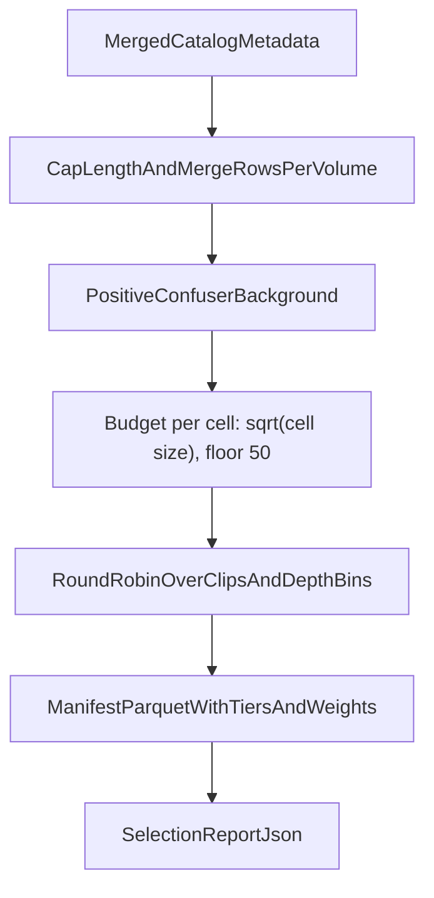

# OD subset sampler for the raw + LL paired dataset

Code lives in the RnD folder (`~/core-learning/RnD/od_raw_ll/scripts/` on `dv-hamed`). The staged build plan (`od_raw_ll_staged_build_ceafe7e8.plan.md`) consumes this design at its Stage 1.

## Source

- Catalog: `s3://ili-ml-datasets/lancedb/research/mahsa/kraken/od_corrosion/ll/merged_7neg_8_10_11_13`, namespace `kraken/od_corrosion`, tables `volumes`, `dataset`, `annotations`. Opened read-only, metadata columns only (never the frame blobs).
- Measured: 61,075 dataset rows, 61,005 volumes, 13,781 OD annotations, 5 inspections, 166 clips, split 54,175 train / 6,900 eval.

## What the subset is

- **Size:** 24,000 volumes: 20,000 train and 4,000 eval. Both are parameters.
- **Sampling unit is the volume, not the dataset row.** 68 volumes carry 2 or 3 dataset rows. 62 of them are OD pairs or triples (two or three OD annotations in one window); 6 are other same-class pairs (4 lamination, 1 nominal, 1 other_corrosion). All share class and split (checked). The sampler merges them into one manifest row with a `sample_ids` list and asserts both properties.
- **Length cap:** drop volumes longer than 330 frames (99th percentile; 607 rows, 430 of them nominal). This avoids the most expensive raw fetches.
- **Three groups** from `anomaly_type`:
  - positive: `od_corrosion`
  - confuser: `other_corrosion`, `id_corrosion`, `lamination`, `inclusion`, `component`, `other`
  - background: `nominal`, `random`

Pool after the cap and the per-volume merge (OD preferred when a volume is shared): train 12,269 positive / 14,779 confuser / 26,533 background; eval 1,428 / 1,295 / 4,095.

## Selection rules



1. **Train mix:** 30% positive (6,000), 35% confuser (7,000), 35% background (7,000). The catalog's natural train mix is 23% / 28% / 49%.
2. **Cells:** inside each group, a cell is inspection x `anomaly_type`. Each cell first gets `min(cell size, 50)`. The rest of the group budget is shared in proportion to the square root of cell size; full cells drop out and their share passes on. Small cells are taken whole.
3. **Order inside a cell:** round-robin across clips, and for OD across clip x depth bin (bins at 0.8, 1.0, 1.3, 2.0 mm), with ties broken by `sha1(f"{seed}:{volume_id}")` and `seed = 20261112`. No `DataFrame.sample`, so the order does not depend on row order or pandas version.
4. **Eval:** all eval positives and all eval confusers (1,428 and 1,295 before the lossless rule), then background by the same cell rule up to 4,000. Eval stays inside the catalog's own eval split. A volume with empty `lossless_frame_*` is skipped and the next lossless volume in that cell is taken. If the cell has no further lossless volume, the volume is dropped and not replaced from train. Depth for the bin is the max `depth_mm` on the volume. Eval rows get `tier` equal to the smallest train tier, so the first fetch is `tier <= 4000`.
5. **Tiers:** the train set is built at budgets 4,000, 8,000, 12,000 and 20,000, and each train volume records the smallest tier that contains it. The raw fetch runs tier by tier. Nesting holds in simulation at all four budgets; the sampler asserts it and fails if any tier is not a subset of the next.
6. **Pilot:** 500 volumes inside the first fetch (train tier 4,000 plus all eval). Take eval positives first until 20, then round-robin over `(inspection_id, split, group)` in the same rank order until 500. The walk must hit all five inspections and both splits; if it cannot, the sampler fails.
7. **Weights:** each volume stores `sample_weight = cell_size / cell_take`, so losses and metrics can be reweighted back to the catalog distribution.

## What the 24k subset looks like (simulated at 20,000 train + 4,000 eval)

The sampler's `selection_report.json` replaces these with exact figures from the real run.

- All 166 clips covered.
- Train share by inspection: `0AP3OOMEPID` 37%, `0ABP0TFUSH1` 21%, `0AGBXB4WEGN` 16%, `0A49KLT3B7Y` 14%, `0A1OLRV96N3` 12%. In the catalog, `0AP3OOMEPID` is 53% of train.
- Train groups: positive 6,000, confuser 7,000, background 7,000.
- OD positives by depth, subset / pool: up to 0.8 mm 693 / 730; 0.8 to 1.0 mm 1,752 / 4,728; 1.0 to 1.3 mm 1,674 / 3,888; 1.3 to 2.0 mm 1,477 / 2,519; above 2.0 mm 404 / 404. The shallow and deep tails are essentially used up at this size.
- Train `sample_weight` ranges from 1.0 to 6.13, median 2.58.
- 2,536,789 frames. LL lossy copy 16.7 GB.
- Raw size 259 GiB **if** raw is 107 KiB per frame. That figure is still an assumption from the prefetch report, not a measurement; Stage 3 of the build plan measures it.
- Windows sharing a 512-frame chunk (assumed aligned; unverified) save about 10% of chunk downloads (28,992 chunk references, 26,039 unique). The sampler does not optimise for this.

## Files

- New `scripts/select_paired_subset.py` (RnD folder):

```python
def load_catalog_metadata(catalog_root: str) -> pd.DataFrame: ...   # one row per volume
def allocate(cell_sizes: dict, budget: int, floor: int = 50) -> dict: ...
def order_cell(cell: pd.DataFrame, seed: int) -> pd.DataFrame: ...
def build_manifest(
    meta: pd.DataFrame, *, train_tiers=(4000, 8000, 12000, 20000), eval_size=4000,
    mix=(0.30, 0.35, 0.35), max_frames=330, pilot_size=500, seed=20261112,
) -> pd.DataFrame: ...
```

  CLI writes `$VOL/work/manifest.parquet` and `$VOL/work/selection_report.json` (per-cell pool, take and weight; depth bins; per-tier frames and estimated raw GiB; overlap count).
- Manifest columns: `volume_id`, `sample_ids` (list), `inspection_id`, `clip_id`, `frame_start`, `n_frames`, `split`, `anomaly_type`, `group`, `depth_bin`, `cell_size`, `cell_take`, `sample_weight`, `tier`, `pilot`.
- New `tests/test_select_paired_subset.py` on a small fake catalog.
- `scripts/catalog_census.py`: `DEFAULT_CATALOG` changed to the merged catalog.

## Checks before the manifest is accepted

- Two runs give a byte-identical parquet (SHA-256).
- No duplicate `volume_id`; every `volume_id` exists in `volumes`; `split` equals the source.
- Tiers are nested; the pilot is inside the first fetch.
- Group totals equal the budgets; no cell takes more than it has.
- Every selected eval volume has lossless frames.
- No overlapping window pair crosses train/eval.
- Every clip in the pool appears in the manifest.

## Not in this plan

Refreshing the deck, canvas and README (`refresh-docs` in the staged build plan). The staged build plan's Stage 1 is the consumer of this design.
