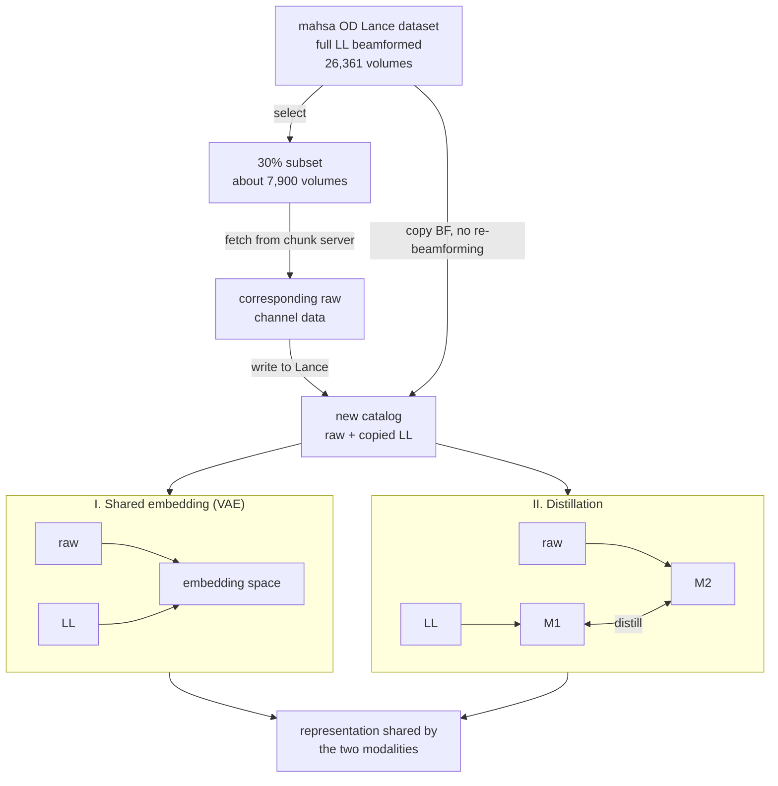

> Superseded 12 Nov 2026. This file describes the retired 26k catalog.
> The build to follow is ../plans/staged_build.plan.md.
> The subset design is ../plans/subset_sampler.plan.md.

# Raw + LL paired dataset for OD corrosion: whiteboard notes and prep estimate

Shareable deck: [od_raw_ll_plan.pptx](od_raw_ll_plan.pptx). Source: whiteboard photo, 10 Nov 2026. Plan: [PLAN.md](PLAN.md).

## The idea

Beamforming (BF) is expensive. For every sample we already have an LL beamformed volume, and the raw channel data it was made from still exists. The goal is a representation shared between the two modalities, so that raw (or an intermediate representation) can give some of what the beamformed image gives.

## What the board says

**Data prep**

1. Start from the mahsa OD Lance dataset: the full dataset of LL beamformed volumes.
2. Take a 30% subset (the box on the board says "10k").
3. For each sample in the subset, fetch the corresponding raw data and write it to Lance.
4. Copy the BF volumes for those samples from the full dataset, alongside the raw, as a new catalog. Nothing is beamformed again.
5. First, estimate how long this data prep takes. (Marked I.)

**Modelling, two options**

- **I. Shared embedding space.** Raw and LL both go into one embedding space (VAE). The board has a question mark on this one.
- **II. Distillation.** LL goes to model M1, raw goes to model M2, and one is distilled into the other.

Both use the new paired catalog.

## Diagram



## What is in the catalog today

Measured on `s3://dv-ml-data/lancedb/user/mahsa/datasets` with `catalog_census.py` (metadata only, read-only).

| | |
|---|---:|
| Volumes | 26,361 |
| Dataset rows | 26,373 |
| Positives (annotations) | 2,326 |
| Frames | 3,083,394 |
| Frames per volume, median / mean / max | 110 / 117 / 1,489 |
| Mode, codec, frame size | `ll`, JP2, 441 x 201 |
| LL lossy bytes | 20.3 GB (6.6 kB per frame) |
| Whole catalog on S3 | 70.7 GB |
| Clips | 143 |

| Inspection | Volumes | Clips | Frames |
|---|---:|---:|---:|
| 0ABP0TFUSH1 | 9,361 | 22 | 1,070,362 |
| 0A49KLT3B7Y | 6,593 | 22 | 782,373 |
| 0A1OLRV96N3 | 6,143 | 33 | 653,904 |
| 0AGBXB4WEGN | 4,264 | 66 | 576,755 |

Split: 24,482 train, 1,891 eval. Positives: 2,154 train, 171 eval.

**30% of this is about 7,900 volumes, not 10k.** 10k volumes would be 38%. Which one the board means needs deciding.

## Data prep estimate

From `estimate.py`. The counts are measured. The raw size and the read speed are **assumed**, because the raw read timing has not been run yet (see below).

| Subset | Volumes | Frames | Raw, uncompressed | LL copy | Raw fetch, 1 worker | Raw fetch, 8 workers | S3 copy + upload |
|---|---:|---:|---:|---:|---:|---:|---:|
| 30% | 7,908 | 925k | 94 GiB | 6.1 GB | 2.0 to 8.3 h | 0.3 to 1.0 h | 12 to 36 min |
| 10k | 10,000 | 1.17M | 119 GiB | 7.7 GB | 2.6 to 10.5 h | 0.3 to 1.3 h | 15 to 45 min |
| Full | 26,361 | 3.08M | 315 GiB | 20.3 GB | 6.8 to 27.8 h | 0.8 to 3.5 h | 40 to 119 min |

So the 30% subset is roughly an afternoon on one worker or about an hour on eight, **if the assumptions hold**.

### What is assumed

| Assumption | Value | Where it comes from |
|---|---|---|
| Raw size per frame | 107 KiB | `od_chunk_prefetch_report.md`: "one 1024-frame span is about 107 MiB decoded". Not checked against the RF buffer shape. |
| Frames per chunk | 512 | Same report: 1024 frames is about two chunks. |
| Download speed, slow end | 225 fps | The pod pipeline rate that prefetch kept ahead of. A floor, not a measurement of the link. |
| Download speed, fast end | 1000 fps | A guess. |
| Fixed cost per volume | 0.3 to 1.0 s | A guess. |
| S3 throughput | 50 to 150 MB/s | A guess. |

Two things follow from the model, whatever the exact numbers:

- **Chunks are downloaded whole.** A 117-frame window touches about 1.2 chunks, so about 630 frames are downloaded to keep 117. Read time scales with the number of volumes, not the number of frames.
- **Raw is the big part.** Uncompressed raw is about 17 times the LL JP2 bytes for the same frames. Lossless compression of raw has not been measured.

### What would replace the assumptions

`time_raw_window.py` reads 16 windows from the catalog (4 per inspection, listed in `sample_windows.json`) as raw RF frames and reports shape, KiB per frame, cold and warm read seconds, and a zlib ratio. It has **not been run**: it needs your ilipy login to read inspection data.

```bash
ili-login -e prod
dv_env/bin/python scripts/od_raw_ll/time_raw_window.py
python3 scripts/od_raw_ll/estimate.py --raw-kib-per-frame <measured> --raw-s-per-volume <measured>
```

A laptop link is slower than a pod, so seconds per volume from a laptop are an upper bound.

### Not usable: the catalog's own timestamps

All 26,361 `created_at` values fall inside the same half second (8 Sep 2026, 19:12:36 UTC). That is a migration stamp, so it says nothing about how long the original LL prep took.

## Files here

| File | What it does |
|---|---|
| `catalog_census.py` | Read-only census of the catalog. Wrote `catalog_census.json`. |
| `sample_windows.json` | 16 real windows for the timing script. |
| `time_raw_window.py` | Raw read timing. Not run yet. |
| `estimate.py` | The table above. Takes measured values as arguments. |
| `PLAN.md` | Implementation plan. |
